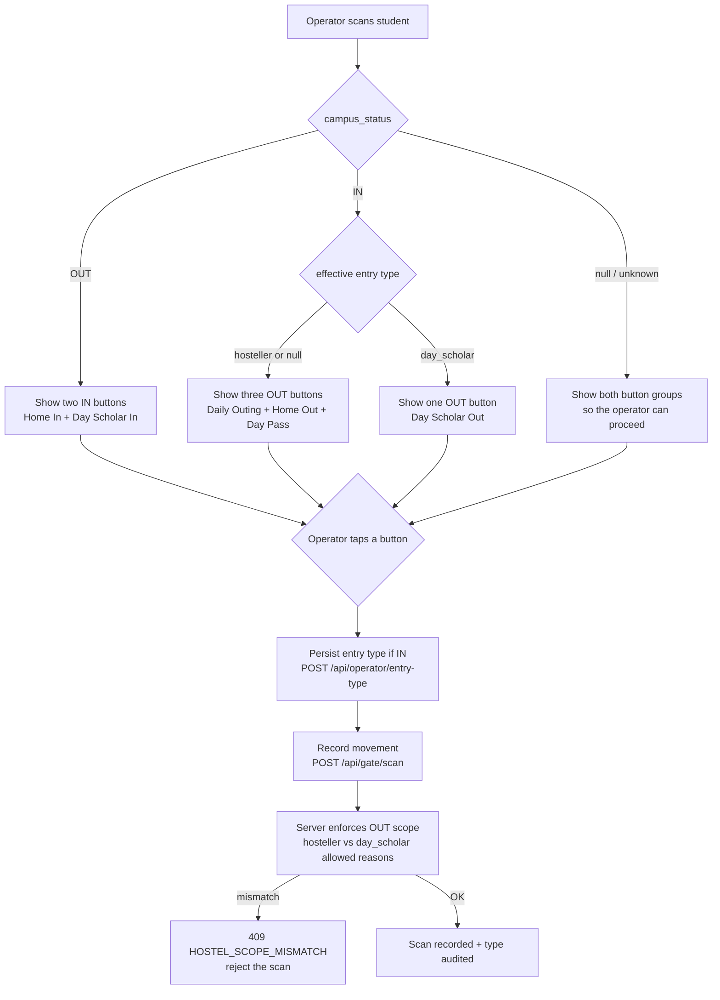
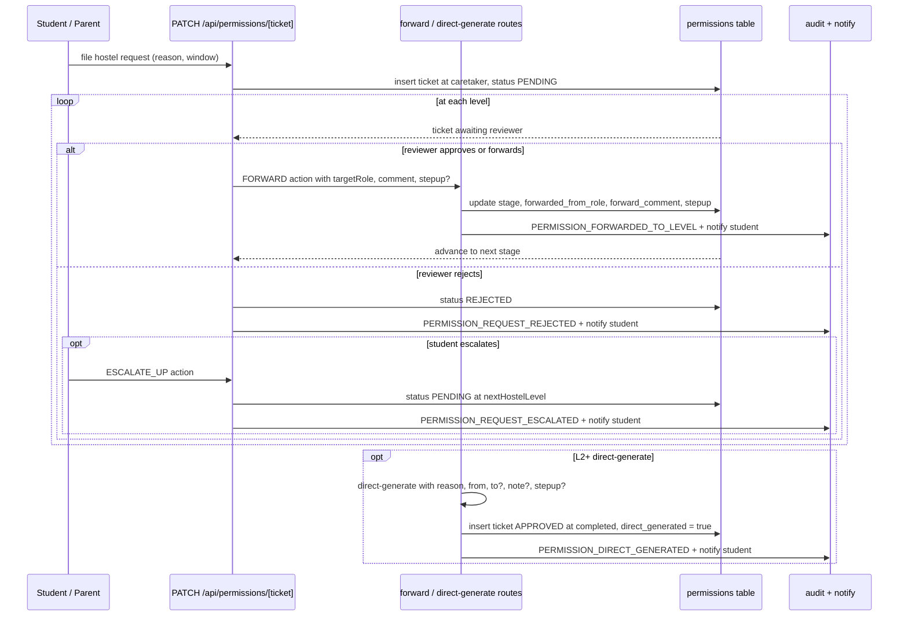

# Hostel Permission Hierarchy and Entry-Type Selection

This feature adds a four-level hostel-approval chain to the existing gate-pass
workflow and introduces type-driven entry/exit at the gate. A student (or
parent) files a hostel pass; the pass is then reviewed stage by stage along
`caretaker -> deputy_warden -> hostel_manager -> principal`. At each stage a
reviewer may approve (advance), reject, request more information, forward to
the next level with a comment, or (from L2 up) issue a direct-generate pass
that skips the staged chain entirely. When a ticket is rejected, the student
may escalate it one level up rather than restarting. Sensitive moves are gated
by a step-up approval password with a lockout policy.

On the operator side, when a student is scanned IN the operator chooses which
type the student is entering as (hosteller or day scholar); that choice is
persisted and later drives which exit reasons are legal when the student is
scanned OUT. This keeps daily scholarly traffic on a single fast path while
still letting hostellers take home visits, full-day passes, and emergency or
special-leave exits.

## Roles and levels

The hostel chain is expressed by four role codes, referenced throughout as
`L1` through `L4`:

| Level | Role code        | Direct-generate | Can forward        | Step-up password trigger |
|-------|------------------|-----------------|--------------------|--------------------------|
| L1    | `caretaker`      | No              | To L2 only         | (per rules below)        |
| L2    | `deputy_warden`  | Yes             | To L3 or L4        | (per rules below)        |
| L3    | `hostel_manager` | Yes             | To L4 only         | Always (any forward)     |
| L4    | `principal`      | Yes             | Not allowed        | (per rules below)        |

`sysadmin` and `admin` are exempt from the "principal cannot forward" rule and
can forward to any level. They may also direct-generate.

Forwarding is always strictly upward: a reviewer may only forward to a role
that appears above their own in the chain. L4 (principal) has no one above it,
so a forward from principal is rejected with a 403 unless the actor is
sysadmin or admin. L1 may only forward to L2. L2 may forward to L3 or L4. L3
may forward to L4.

Direct-generate is available to L2, L3, L4 and the sysadmin/admin exemptions.
L1 (caretaker) may not call it and is rejected with a 403.

## Entry-type button matrix (operator acceptance matrix)

The gate operator console shows a confirmation card after a student's QR or
roll has been scanned. The visible buttons are determined by two things:
the student's last known campus status (`IN`, `OUT`, or null/unknown) and
their effective entry type (`hosteller` or `day_scholar`; null defaults to
hosteller with a warning).

| Campus status | Effective entry type | Buttons offered                              | Pass-gated buttons |
|---------------|----------------------|----------------------------------------------|--------------------|
| `OUT`         | any (or null)        | `[Home In]` `[Day Scholar In]`               | None               |
| `IN`          | `hosteller` (or null) | `[Daily Outing]` `[Home Out]` `[Day Pass]`   | `Home Out`, `Day Pass` |
| `IN`          | `day_scholar`        | `[Day Scholar Out]` only                     | None               |
| `null`        | any (or null)        | Both groups above are shown so the operator can proceed | `Home Out`, `Day Pass` |

Notes on the matrix:

- `Home In` always carries `entryType = "hosteller"`; `Day Scholar In` always
  carries `entryType = "day_scholar"`. Those are the only two entry types and
  both are IN moves.
- `Daily Outing`, `Home Out`, and `Day Pass` are all OUT moves offered to
  hostellers (and to the hosteller-default when the stored type is missing).
- A day scholar IN on campus has exactly one legal OUT move: `Day Scholar
  Out`. If the operator tries to close the day scholar with a hosteller
  reason (e.g. `Home Out`), the server rejects the scan with a
  `HOSTEL_SCOPE_MISMATCH` 409 conflict.
- The two buttons that require an approved gate pass on file are `Home Out`
  and `Day Pass`. The confirmation card fetches the student's APPROVED
  gate passes and disables those two buttons when no matching pass is
  present. The other buttons are always enabled (subject to the photo
  verification countdown and security-flag check).

The full flow is:

## Step-up approval password

A small subset of moves require a password check on top of the login session:

- Any forward where the target level is L4 (principal).
- A direct-generate where the actor is L3 (hostel_manager) or L4 (principal).
- Any override-of-rejection.
- Any move where the ticket's reason is `emergency` or `special_leave`.
- Any move where the student already has 3 or more prior violations.
- Any move where the actor has already performed 5 or more bulk approvals
  today.

The password is stored as a bcrypt hash on `users.approval_password_hash`.
Set it once via `POST /api/auth/approval-password/set` (authenticated with
the login password) or rotate it via
`POST /api/auth/approval-password/rotate` (authenticated with the current
approval password).

Policy:

- Minimum length 8 characters.
- Must differ from the login password and from the current approval password.
- Both set and rotate clear the step-up failure counter and any active
  lockout.
- Rotate is refused while the approval password is already locked.

Lockout:

- Up to 5 consecutive failed attempts are allowed; on the 5th failure the
  counter is reset to zero and `approval_password_locked_until` is set to
  now + 15 minutes.
- While locked, every step-up check returns a 403 without touching the
  stored hash.
- Every failure is audited as `PERMISSION_STEPUP_FAILED`; every successful
  verification is audited as `PERMISSION_STEPUP_VERIFIED` at the point of
  use (forward, direct-generate, or the `APPROVE` path).

## Approval workflow

The pure decision engine in `src/lib/permission-workflow.ts` exposes two
functions that carry the forward and direct-generate branches:

- `forwardTicket` validates the target is strictly above the actor's level,
  requires a non-empty comment, and requires step-up verification when
  `requiresStepup(..., action: "forward")` says so. It returns the update
  fields to persist plus an audit action (`PERMISSION_HOSTEL_FORWARDED`) and
  a notification to the student.
- `directGeneratePass` rejects L1, applies the step-up predicate for the
  `direct_generate` action, and returns the update fields plus an audit
  action (`PERMISSION_DIRECT_GENERATED`) and a notification.

The L4 plumbing in `src/lib/permission-forward.ts` wraps those with the
step-up lockout check, the `permissions` table writes, and the audit and
notification calls. The extended `PATCH /api/permissions/[ticket]` also
supports an `ESCALATE_UP` action that calls `prepareEscalateUp` /
`applyEscalateUp`, which moves a `REJECTED` hostel ticket to the next level
via `nextHostelLevel` and re-opens it as `PENDING`.

## Data model deltas

The migration `20261201000000_hostel_hierarchy_and_type_selection.sql` adds
additive-only columns and registers the four role codes in the
`config_roles_registry`:

On `users`:

- `approval_password_hash TEXT` - the actor's bcrypt approval password hash.
- `approval_password_set_at TIMESTAMPTZ` - when it was last set or rotated.
- `approval_password_failed_count INT DEFAULT 0` - consecutive failures;
  drives the lockout heuristic.
- `approval_password_locked_until TIMESTAMPTZ` - lockout expiry; when in the
  future, every step-up check short-circuits with a 403.

On `student_details`:

- `current_entry_type TEXT CHECK (current_entry_type IN ('hosteller',
  'day_scholar'))` - the entry type the operator last recorded.
- `type_chosen_at TIMESTAMPTZ` - timestamp of that selection.
- `type_chosen_at_gate UUID REFERENCES gates(id)` - the gate where it was
  chosen.

On `permissions`:

- `routed_to_role TEXT` - the level the ticket is currently routed to.
- `forwarded_from_role TEXT` - the role that forwarded it.
- `forward_comment TEXT` - free-text annotation attached at forward time.
- `direct_generated BOOLEAN DEFAULT FALSE` - true when the ticket was
  produced by the direct-generate route instead of the staged chain.
- `stepup_verified_at TIMESTAMPTZ` - when a step-up check passed for this
  ticket.
- `stepup_verified_by UUID REFERENCES users(id)` - who verified it.

Two partial indexes are added to support the routing queries:
`idx_permissions_routed_to` on `(routed_to_role, status) WHERE status =
'PENDING'` and `idx_permissions_direct_generated` on
`permissions(direct_generated) WHERE direct_generated`.

Seven new audit actions are spliced into the
`audit_logs_action_known` CHECK constraint:

- `PERMISSION_FORWARDED_TO_LEVEL`
- `PERMISSION_DIRECT_GENERATED`
- `PERMISSION_STEPUP_VERIFIED`
- `PERMISSION_STEPUP_FAILED`
- `STUDENT_TYPE_CHANGED_AT_ENTRY`
- `APPROVAL_PASSWORD_ROTATED`
- `APPROVAL_PASSWORD_SET`

## API surface

New routes introduced by the feature:

- `POST /api/permissions/[ticket]/forward` - forward a ticket to a
  strictly-higher level. Body: `{ targetRole, comment, stepupPassword? }`.
  Runs the L4 `prepareHostelForward` / `applyHostelForward` pipeline.
- `POST /api/permissions/direct-generate` - generate an approved pass
  directly, bypassing the staged chain. Body: `{ studentUserId, reason,
  from, to?, note?, stepupPassword? }`. L2+ only.
- `POST /api/operator/entry-type` - persist the entry-type choice at the gate.
  Body: `{ roll, entryType, gateId }`. Operator must be bound to the gate;
  the student must currently be OUT.
- `POST /api/auth/approval-password/set` - install or re-install the actor's
  approval password. Body: `{ newPassword, currentPassword }`.
- `POST /api/auth/approval-password/rotate` - rotate an existing approval
  password. Body: `{ currentApprovalPassword, newPassword }`. Refused while
  locked.

Extended `PATCH /api/permissions/[ticket]` actions:

- `FORWARD` - the same forward path as the dedicated route, but invoked
  inline from the ticket panel.
- `ESCALATE_UP` - student-initiated move to the next hostel level after a
  rejection. The ticket must currently be `REJECTED`.
- `APPROVE` with a step-up flag - when the ticket's reason is `emergency` or
  `special_leave`, an `APPROVE` also goes through the step-up password check
  and audits `PERMISSION_STEPUP_VERIFIED` on success.

## Acceptance scenario matrix

Each of the 14 scenarios the task asks for maps to a specific enforcement
point in the code:

| # | Scenario | Where it is enforced |
|---|----------|----------------------|
| A1 | OUT + unknown stored type defaults to hosteller | `record.ts` `findStudentDetailsByUserId` + `console.warn`; UI card badge shows "Defaulting to Hosteller" |
| A2 | OUT + hosteller allowed exits are `daily_outing`, `home_out`, `day_pass`, `emergency` | `record.ts` `OUT_REASONS_BY_ENTRY_TYPE.hosteller` + `enforceOutScopeByEntryType` |
| A3 | OUT + day_scholar is limited to `day_scholar_out` only | `record.ts` `OUT_REASONS_BY_ENTRY_TYPE.day_scholar` |
| A4 | OUT with a disallowed reason for the stored type is a 409 `HOSTEL_SCOPE_MISMATCH` | `record.ts` `enforceOutScopeByEntryType` throws `ConflictError` |
| A5 | IN + hosteller offers three OUT buttons, with Home Out and Day Pass pass-gated | `ScanConfirmation.tsx` button matrix |
| A6 | IN + day_scholar offers exactly one OUT button, `Day Scholar Out` | `ScanConfirmation.tsx` button matrix |
| A7 | IN requires an entry-type selection; a missing type on an IN scan is rejected early | `record.ts` throws `BadRequestError` code `ENTRY_TYPE_REQUIRED` |
| A8 | A caretaker cannot direct-generate; L2+ can | `directGeneratePass` + `DIRECT_GENERATE_ROLES` + route gate |
| A9 | A principal cannot forward; sysadmin/admin are exempt | `prepareHostelForward` (role ban + `SYSADMIN_LIKE` exemption) |
| A10 | Forward to L4 requires step-up verification | `requiresStepup` (`forward` + `targetRole === L4_ROLE`) |
| A11 | Direct-generate from L3 or L4 requires step-up verification | `requiresStepup` (`direct_generate` + L3/L4 actor) |
| A12 | 5 consecutive step-up failures lock the password for 15 minutes | `applyStepupFailure` in `permission-forward.ts` |
| A13 | Student can escalate a rejected hostel ticket one level up | `prepareEscalateUp` / `applyEscalateUp` + `nextHostelLevel` |
| A14 | `HOME_OUT_MAX_HOURS = null` (unlimited); `DAILY_OUTING_MAX_HOURS = 1`; `DAY_PASS_MAX_HOURS = 12` | Constants in `permission-workflow.ts` + `maxDurationForReason` in the direct-generate route |
