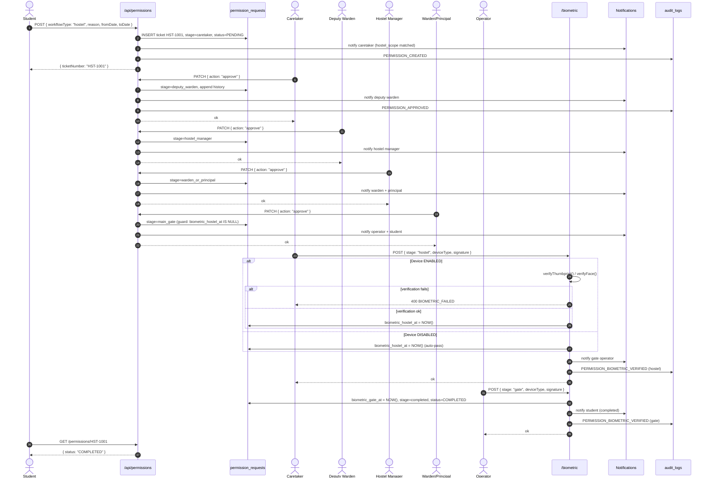
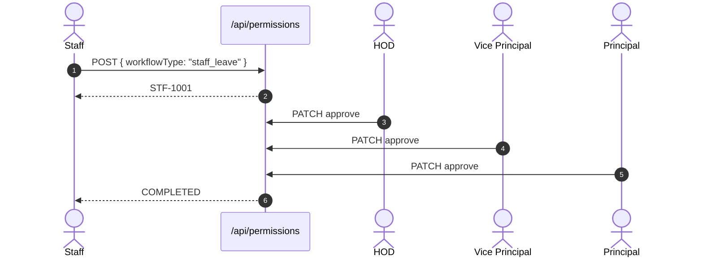
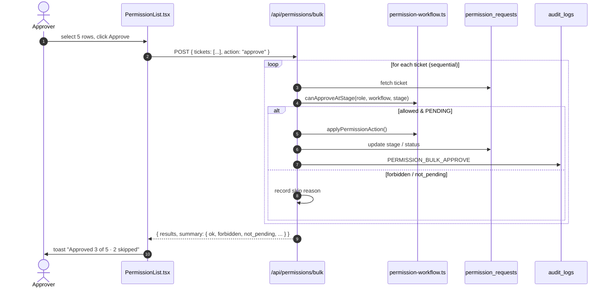
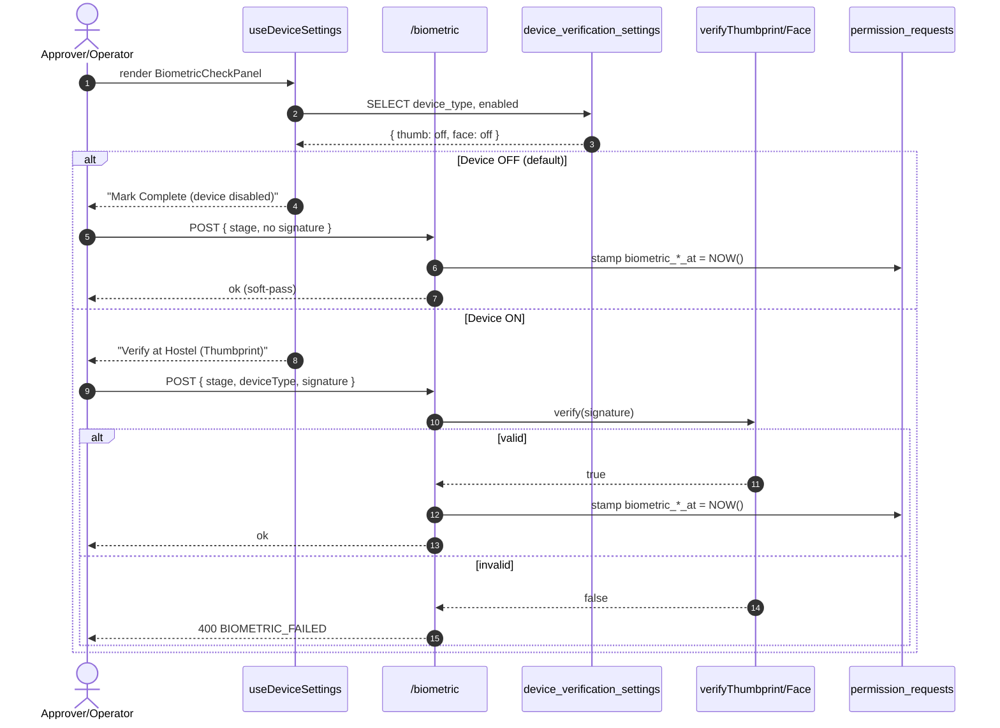
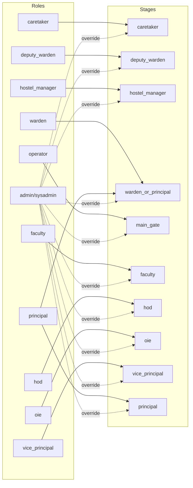

# Permission Workflow — Sequence Diagrams

All diagrams use Mermaid syntax. 
---

## 1. Hostel Permission — End-to-End



---

## 2. Exam Document — Full Flow

```mermaid
sequenceDiagram
    autonumber
    actor S as Student
    participant API as /api/permissions
    participant UP as /upload
    participant DOC as /document
    participant SIGN as /sign
    participant DB as permission_requests
    actor F as Faculty
    actor H as HOD
    actor O as OIE
    actor VP as Vice Principal
    actor P as Principal
    participant A as audit_logs

    S->>API: POST { workflowType: "exam", documentRequired: true }
    API->>DB: EXM-1001, stage=faculty, status=PENDING
    API-->>S: ticketNumber

    F->>API: PATCH { action: "approve" }
    API->>DB: stage=hod

    H->>API: PATCH { action: "approve" }
    API->>DB: stage=oie

    Note over S,UP: HOD approved — student can now upload
    S->>UP: POST multipart { file: document.pdf }
    UP->>UP: validate PDF, size <= 10MB
    UP->>UP: write data/uploads/permissions/EXM-1001/document.pdf
    UP->>DB: document_url = /api/permissions/EXM-1001/document
    UP-->>S: { documentUrl }

---

## 3. Memo Workflow

```mermaid
sequenceDiagram
    autonumber
    actor S as Student
    participant API as /api/permissions
    actor F as Faculty
    actor H as HOD
    actor O as OIE
    actor VP as Vice Principal
    actor P as Principal
    participant SIGN as /sign

    S->>API: POST { workflowType: "memo", documentRequired: true }
    API-->>S: MEM-1001

    F->>API: PATCH approve
    H->>API: PATCH approve
    S->>API: POST /upload { document.pdf }
    O->>API: PATCH approve
    VP->>API: PATCH approve
    P->>SIGN: POST sign
    SIGN-->>S: COMPLETED
```

---

## 4. Staff Leave Workflow



---

## 5. Bulk Approve Flow



---

## 6. Biometric Verification (Device ON vs OFF)



---

## 7. Role → Stage Authorization



    O->>API: PATCH { action: "approve" }
    API->>DB: stage=vice_principal

    VP->>API: PATCH { action: "approve" }
    API->>DB: stage=principal

    P->>DOC: GET preview
    DOC-->>P: PDF stream (inline)

    P->>SIGN: POST { signatureNote }
    SIGN->>SIGN: signature_hash = SHA-256(pdf || ticket || signerId || ts)
    SIGN->>SIGN: copy document.pdf -> document_signed.pdf
    SIGN->>DB: INSERT document_signatures
    SIGN->>DB: digital_signature = hash, stage=completed, status=COMPLETED
    SIGN-->>P: { signatureHash }

    S->>DOC: GET signed PDF
    DOC-->>S: document_signed.pdf
```